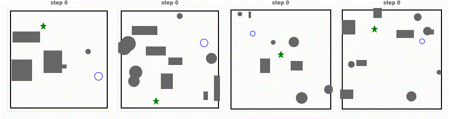
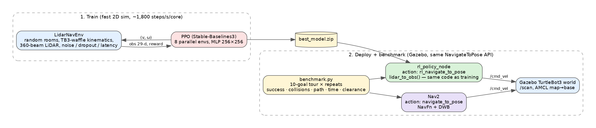
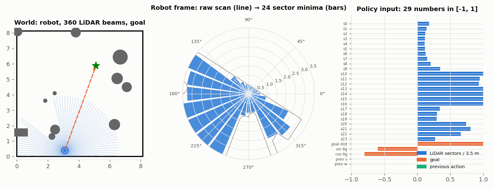
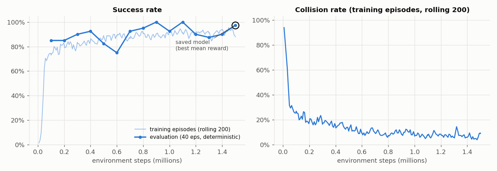
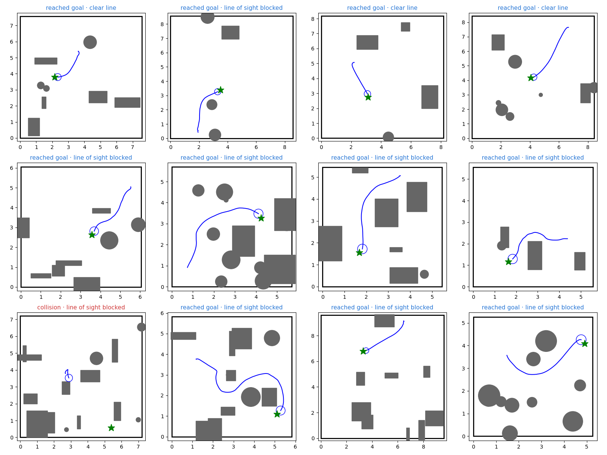
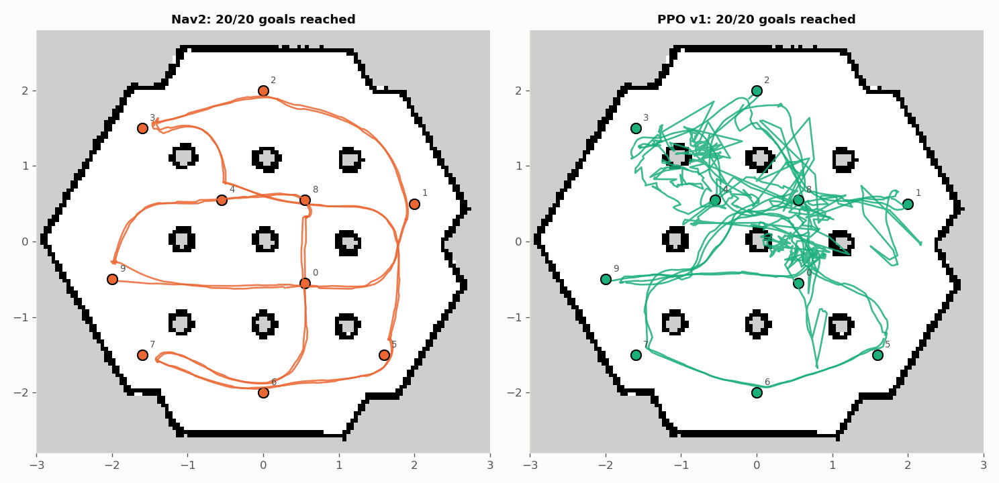
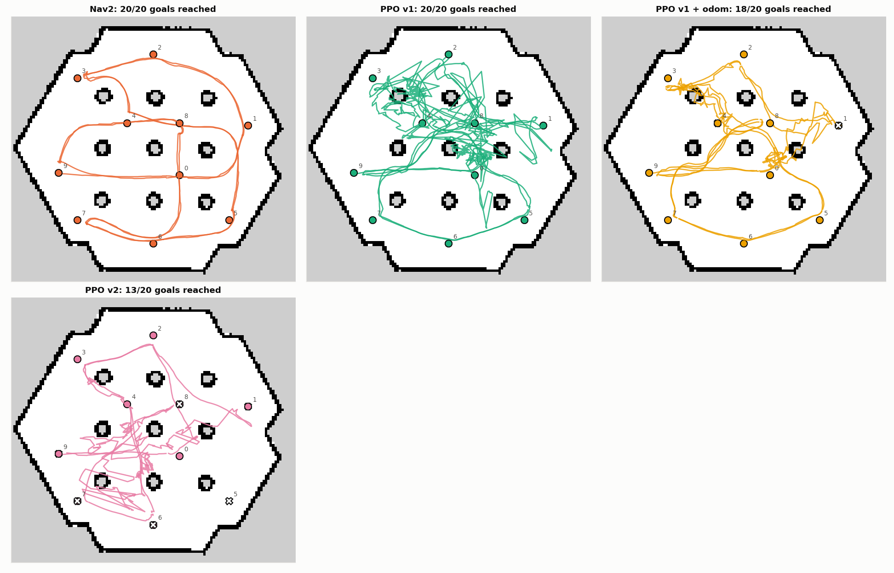
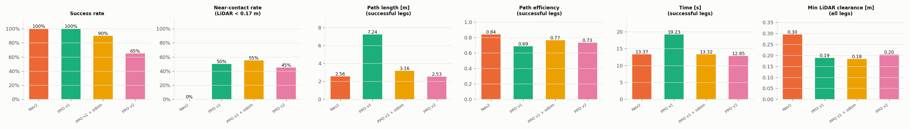
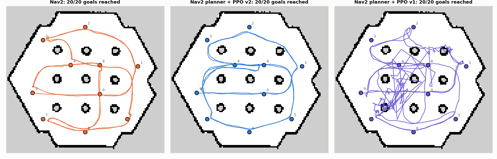
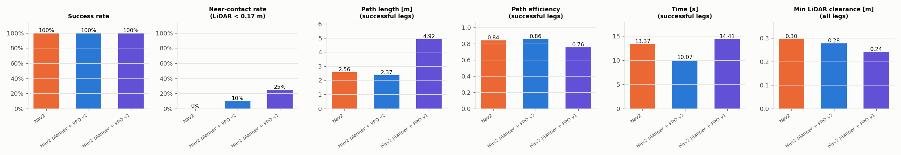

# rl_nav — Reinforcement-learning navigation vs. Nav2

A PPO policy that drives a TurtleBot3 to a goal using only its 2D LiDAR and the goal's relative
position. It is trained in a fast custom 2D simulator, deployed **zero-shot** in Gazebo through
the same `NavigateToPose` action interface Nav2 uses, and benchmarked against Nav2 on an
identical goal tour.



*Four unseen random worlds: the policy (blue path) drives from its start to the green star.*

**Headline:** used as a **local controller on Nav2's global path**, the PPO policy matched Nav2's
100% success over a 20-leg Gazebo tour and was **25% faster with 7% shorter paths** than Nav2's
DWB controller. It had slightly less clearance: 2 of 20 legs came within 0.14 m of an obstacle.
On its own, without a global planner, it was not competitive (§5). That gap, and how it was
closed, is the main lesson of the project.


> Part of my Physical AI project set: [lang_nav](https://github.com/Deivaprakash56/-vlm-language-navigation-ros2) (Language-guided navigation) · [il_arm](https://github.com/Deivaprakash56/imitation-learning-pick-and-place) (Imitation learning for pick-and-place).
> Everything here runs in simulation. The ROS 2 interfaces are the same ones a real robot uses.

## Quick start

Requirements: Ubuntu 22.04, ROS 2 Humble, Nav2 and Gazebo 11, Python 3.10.

```bash
git clone https://github.com/Deivaprakash56/rl-navigation-vs-nav2.git ~/rl_nav && cd ~/rl_nav
python3 -m venv --system-site-packages .venv && touch .venv/COLCON_IGNORE
.venv/bin/pip install torch --index-url https://download.pytorch.org/whl/cpu
.venv/bin/pip install "numpy<2" stable-baselines3 gymnasium matplotlib tensorboard imageio pyyaml

# TurtleBot3 Gazebo models (no sudo; or: sudo apt install ros-humble-turtlebot3-gazebo)
mkdir -p third_party/deb && (cd third_party/deb && apt-get download ros-humble-turtlebot3-gazebo \
    && dpkg -x ros-humble-turtlebot3-gazebo_*.deb ../tb3_gazebo) && touch third_party/COLCON_IGNORE

source /opt/ros/humble/setup.bash && colcon build --symlink-install
source env.sh                                   # in every new terminal
python -m pytest -q src/rl_nav/test
```

Pretrained policies are included (`runs/ppo_v1/`, `runs/ppo_v2/`), as are the benchmark results (`results/`), so the Gazebo commands in [Running it](#6-running-it) work without training first.


---

## Contents

1. [Pipeline](#1-pipeline)
2. [The environment](#2-the-environment)
3. [Training](#3-training)
4. [Results in the 2D simulator](#4-results-in-the-2d-simulator)
5. [Benchmark against Nav2 in Gazebo](#5-benchmark-against-nav2-in-gazebo)
6. [Running it](#6-running-it)
7. [Code map](#7-code-map)
8. [Sim-to-real checklist](#8-sim-to-real-checklist)
9. [Lessons and next steps](#9-lessons-and-next-steps)

---

## 1. Pipeline



Two choices make the comparison fair and the transfer work:

- **The same observation code in training and deployment.** `lidar_to_obs()` and
  `goal_features()` in `lidar_nav_env.py` are imported by the ROS node. There is no
  re-implementation that could drift.
- **The same action interface as Nav2.** The policy node is a `nav2_msgs/NavigateToPose` action
  server (`rl_navigate_to_pose`), so one benchmark client drives both planners with identical
  goals, timeouts and metrics.

---

## 2. The environment

`LidarNavEnv` (Gymnasium) is a 2D world sized to the TurtleBot3 Waffle:

| | |
|---|---|
| World | square room 5–10 m, 4–14 random circles (r 0.1–0.5 m) and boxes (0.2–1.6 m), new each episode |
| Robot | disc r = 0.22 m, unicycle kinematics, 0.2 s control step (TB3 Gazebo LiDAR rate is 5 Hz), 4 collision sub-steps |
| LiDAR | 360 beams, 0.12–3.5 m, vectorised ray casting (walls, circles, slab test for boxes) |
| Goal | 1–6 m from the start, both sampled with clearance |
| Episode end | goal within 0.25 m, collision, or 400 steps (80 s) |

**Observation, 29 numbers in [−1, 1]**



*Left: a world with the 360 beams. Middle: the raw scan in the robot frame (line) and the
24 sector minima the policy sees (bars). Right: the full input vector.*

- 24 LiDAR sectors: the **minimum** range in each 15° sector, divided by 3.5 m. The minimum is
  conservative: a thin obstacle in a sector cannot be averaged away.
- Goal: distance / 5 m (clipped), sin and cos of the bearing (no wrap-around at ±180°).
- Previous (v, ω): lets the policy learn smooth control.

**Action:** (v, ω) ∈ [−1, 1]², scaled to v ∈ [−0.05, 0.26] m/s (a little reverse to escape
tight spots) and ω ∈ [−ω_max, ω_max].

**Reward per step**

```
r =  10 · (previous distance − distance)          progress toward the goal
   − 0.02                                         time
   − 0.02 · |ω| / ω_max                           wiggling
   + r_near · (1 − clearance / margin)            only while clearance < margin
   + 20 on reaching the goal,  −20 on collision
```

**Domain randomisation for sim-to-real:** Gaussian LiDAR noise (σ = 2 cm), 1% of beams dropped
to `inf`, action noise (σ = 0.03), and 0–1 steps of actuation latency per episode.

### v1 → v2

| | v1 (first attempt) | v2 |
|---|---|---|
| ω_max | 1.82 rad/s (TB3 hardware limit) | **1.0 rad/s** (Nav2's DWB limit) |
| obstacle penalty | −0.1, below 0.22 m clearance | **−0.3, below 0.25 m** |
| deployment frame | `map` (AMCL pose) | **`odom`** (smooth), goal moved by map→odom |

The reasons for each change are in §5.

---

## 3. Training

PPO (Stable-Baselines3), 8 parallel environments, MLP 256×256 for actor and critic, n_steps 1024,
batch 512, 10 epochs, lr 3e-4, γ 0.99, entropy 0.005, initial log-std −0.5. A deterministic
evaluation on 40 episodes runs every 100k steps; the checkpoint with the best mean reward is
kept.



*PPO v1. Success on training episodes passes 80% within 200k steps. The 40-episode
evaluation points are noisy (±7 points), so the final numbers below use 300 episodes.
Training stopped at 1.5M steps: evaluation success had plateaued at 90–100% since 0.9M.*

| | v1 | v2 |
|---|---|---|
| steps | 1.5M | 1.5M |
| wall time (8 workers, shared machine) | ≈ 25 min | ≈ 60 min |
| best evaluation success (40 eps) | 100% | 87.5% |
| saved checkpoint | 1.5M steps | best mean reward |

---

## 4. Results in the 2D simulator

300 episodes in unseen random worlds (seeds from 10 000), deterministic policy.

| Policy | Success | Collision | Timeout | Success, line of sight **blocked** (108 eps) | Success, line of sight clear (192 eps) | Path efficiency |
|---|---|---|---|---|---|---|
| random actions | 5% | 90% | 5% | 0% | 3% | 0.59 |
| **PPO v1** (ω ≤ 1.82) | **92.3%** | 6.3% | 1.3% | **78.7%** | 100% | 0.93 |
| PPO v2 (ω ≤ 1.0, larger margin) | 81.0% | 9.7% | 9.3% | 47.2% | 100% | 0.94 |

Path efficiency = straight line from start to where the robot stopped ÷ distance travelled,
over successful episodes.

The overall success rate hides where the difficulty is. In about two thirds of random worlds
the straight line to the goal is free. The table therefore splits episodes by whether that
line is **blocked** by an obstacle.



*Episodes from the evaluation, chosen to favour blocked line-of-sight cases. Red titles are
failures.*

---

## 5. Benchmark against Nav2 in Gazebo

**Setup.** Nav2 `tb3_simulation_launch.py` (TurtleBot3 Waffle in the TurtleBot3 world:
hexagonal arena, 3×3 pillar grid). AMCL localisation runs for both methods. The robot visits
10 goals in order ([`config/benchmark_goals.yaml`](src/rl_nav/config/benchmark_goals.yaml)), twice
(20 legs). Every leg crosses the pillar grid. Each method gets a fresh simulation.
Nav2 uses its default NavFn planner + DWB controller.

**Metrics per leg**

| Metric | Definition |
|---|---|
| success | action result SUCCEEDED and robot within 0.35 m of the goal |
| near-contact | minimum LiDAR range during the leg < 0.17 m (the hull is 0.1–0.2 m from the sensor). Gazebo has no contact sensor in this model, so this is a proxy for a collision. |
| path length | integrated from `map → base_footprint` |
| path efficiency | straight distance start→stop / path length |
| time | simulated seconds |
| min clearance | minimum LiDAR range during the leg |

### Iteration 1: PPO v1 vs Nav2



| | Nav2 | PPO v1 |
|---|---|---|
| success | 20/20 | 20/20 |
| near-contact legs | 0% | 50% |
| path length (m) | 2.56 | 7.24 |
| time per leg (s) | 13.4 | 19.2 |
| mean min clearance (m) | 0.30 | 0.19 |

Two problems show in the paths:

1. **Teleporting trajectories.** The straight jumps of more than 1 m in under 0.2 s are not motion:
   they are AMCL relocalising. Nav2 had none; PPO v1 had them on 4 legs, adding about 36 m of fake
   path. The cause was the policy spinning at up to 1.82 rad/s (the TB3 hardware limit; Nav2's DWB
   caps at 1.0) with a 5 Hz LiDAR, so AMCL lost track. Because v1 steered by the AMCL pose, a pose
   jump redirected the robot and it wandered.
2. **Skimming obstacles.** The training reward only penalised clearance below the robot radius,
   so the policy learned to pass close. Half the legs went within 0.17 m of the scanner.

### Iteration 2: v1 deployed in the odom frame, and PPO v2

Three changes, each tested separately:

- **odom-frame control** (deployment only). The robot pose for the policy comes from
  `odom → base_footprint`, which is smooth. The goal is re-expressed in `odom` every tick through
  AMCL's `map → odom`, which is how Nav2's local controller works.
- **v2 training**: ω ≤ 1.0 rad/s (Nav2's limit) and a 3× obstacle penalty that starts 0.25 m out.
- **hybrid**: Nav2's planner server (`compute_path_to_pose`, NavFn) re-plans every 2 s, and the
  policy steers toward a point 0.8 m ahead on that path. The policy now replaces only DWB, the
  local controller.





| Variant | Success | Near-contact | Path (m)\* | Time (s)\* | Min clearance (m) |
|---|---|---|---|---|---|
| Nav2 (NavFn + DWB) | **100%** | **0%** | 2.56 | 13.4 | **0.30** |
| PPO v1, map frame | 100% | 50% | 7.24 | 19.2 | 0.19 |
| PPO v1, odom frame | 90% | 55% | 3.16 | 13.3 | 0.18 |
| PPO v2, odom frame | 65% | 45% | 2.53 | 12.8 | 0.20 |
| **Nav2 planner + PPO v2** | **100%** | 10% | **2.37** | **10.1** | 0.28 |
| Nav2 planner + PPO v1 | 100% | 25% | 4.92 | 14.4 | 0.24 |

\* mean over successful legs.

**What each change did**

- *odom frame* removed the teleporting. v1's path length fell from 7.24 m to 3.16 m and its time
  matched Nav2's. The skimming stayed.
- *v2 training* was **worse on its own**, both in 2D (blocked-line success 79% → 47%) and in Gazebo
  (65%). Slower turning makes it harder for a reactive policy to escape when an obstacle blocks
  the straight line. The larger safety margin did not lower near-contacts much either.
- *the global planner* fixed what the policy cannot do alone. Every leg in this tour crosses the
  pillar grid, and a policy that only knows "the goal is over there" walks into dead ends.
  With a carrot 0.8 m ahead on a collision-free path, the line of sight is almost never blocked.
  That is the regime where the policy succeeds 100% of the time in 2D.





The hybrid with v2 is the configuration to keep. Same success as Nav2, a quarter less time,
shorter paths. In exchange, 2 legs passed within 0.13–0.14 m of a pillar against Nav2's closest
0.24 m. DWB scores every trajectory against the inflated costmap; the policy only has its reward
shaping.

---

## 6. Running it

```bash
cd ~/rl_nav && source env.sh

# train + evaluate in 2D
python -m rl_nav.train_ppo --env LidarNav-v2 --timesteps 1500000 --n-envs 8 --out runs/ppo_v2
tensorboard --logdir runs
python -m rl_nav.eval_2d runs/ppo_v2/best_model.zip --episodes 300 --cfg v2 --plot traj.png

# Gazebo: one goal by hand
ros2 launch rl_nav rl_nav_sim.launch.py model_path:=$PWD/runs/ppo_v2/best_model.zip headless:=False
ros2 action send_goal /rl_navigate_to_pose nav2_msgs/action/NavigateToPose \
  "{pose: {header: {frame_id: map}, pose: {position: {x: 0.55, y: -0.55}, orientation: {w: 1.0}}}}"

# Gazebo: full benchmark (fresh sim per method, own ROS domain 77 + Gazebo port 11377)
scripts/run_nav_benchmark.sh runs/ppo_v2/best_model.zip 2                 # nav2 + rl
scripts/run_nav_benchmark.sh runs/ppo_v2/best_model.zip 2 rl rl_v2        # rl only, named rl_v2

# figures
python -m rl_nav.plot_results training runs/ppo_v2 --out src/rl_nav/docs
python -m rl_nav.plot_results benchmark results/nav2.csv results/rl_v2.csv --out src/rl_nav/docs
```

Node parameters (`rl_policy_node`): `model_path`, `global_frame` (map), `odom_frame` (odom),
`use_odom_control` (true), `robot_frame` (base_footprint), `control_rate` (5 Hz, on sim time),
`timeout_s` (120), `scan_timeout_s` (1.0), `v_scale` (1.0; use about 0.6 on a real robot at first).
Robot limits are read from `robot_cfg.json`, which training saves next to the model.

Tests: `python -m pytest -q src/rl_nav/test` (Gym API check, ray casting against walls,
circles and boxes, sector binning, episode loop).

---

## 7. Code map

```
rl_nav/
├── rl_nav/
│   ├── lidar_nav_env.py     # LidarNavEnv, World ray casting, lidar_to_obs / goal_features, v1/v2 presets
│   ├── train_ppo.py         # SB3 PPO, success/collision logging, checkpoints, robot_cfg.json
│   ├── eval_2d.py           # held-out evaluation, blocked vs clear split, trajectory grid
│   ├── rl_policy_node.py    # ROS 2 NavigateToPose server running the policy (odom-frame control)
│   ├── benchmark.py         # drives nav2 or rl through the goal tour; CSV + trajectories; --compare
│   ├── set_initial_pose.py  # AMCL initial pose without RViz
│   └── plot_results.py      # README figures
├── config/benchmark_goals.yaml
├── launch/rl_nav_sim.launch.py
├── docs/
└── test/test_env.py
```

---

## 8. Sim-to-real checklist

1. **LiDAR:** check `/scan` angle convention (0 rad = forward, CCW) and that invalid returns are
   `inf` or below `range_min`. `_scan_to_360()` resamples any beam count to 360.
2. **Limits:** keep ω_max = 1.0 rad/s (v2); start with `v_scale:=0.6`.
3. **Frames:** odom-frame control needs a decent `odom` (wheel + IMU EKF). AMCL or SLAM only
   moves the goal.
4. **Latency:** training randomised 0–1 steps (0–0.2 s). Measure scan→cmd_vel on the robot; if
   it is larger, retrain with `latency_steps_max` raised.
5. **Course:** tape out the same 10-goal tour and run `benchmark.py` unchanged.

---

## 9. Lessons and next steps

1. **A reactive RL policy is a local controller, not a navigator.** It excelled where the line of
   sight was clear (100% in 2D) and failed in dead ends. Pairing it with a global planner is
   standard practice, and it is where the policy beat a hand-tuned controller.
2. **Measure what you think you measure.** Two metric bugs were found from results that looked
   wrong: path efficiency above 1 (it measured to the goal centre, but the robot stops 0.25 m
   early), and "path length" inflated by localisation jumps. Plot the trajectories, not just
   the averages.
3. **Control in a smooth frame.** Feeding a policy (or any controller) the AMCL pose makes it
   chase every relocalisation. Nav2's controllers run in `odom` for this reason.
4. **Match the deployment limits during training.** Changing ω_max *after* training is a different
   robot. v2 retrained with Nav2's limits; on its own that cost manoeuvrability. With the planner
   providing the route, v2 was both faster (10.1 s against 14.4 s per leg) and safer (10% against
   25% near-contacts) than v1. v1's fast spinning still made AMCL lose track (the straight jumps in
   the right-hand panel, which also inflate its 4.92 m path length).
5. **Fair benchmarking takes work**: the same action API, a fresh simulation per method, simulated
   time for timing, a sim-time control rate (otherwise a slow simulation gives RL more decisions
   per simulated second), and an isolated ROS domain and Gazebo port.

**Next steps**

- Add the global-planner carrot to *training* (random waypoints along A* paths in the 2D worlds),
  so the policy learns to follow paths rather than chase goals.
- Feed a few costmap rays or the inflated-obstacle distance to the policy to close the clearance gap.
- Recurrent policy (LSTM) or frame stacking for partially observed dead ends.
- Sim-to-real on a physical TurtleBot3 with the checklist in §8.
